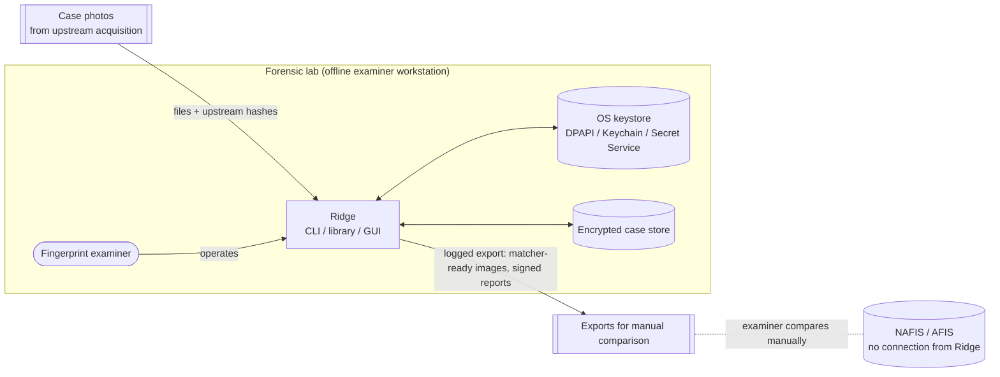
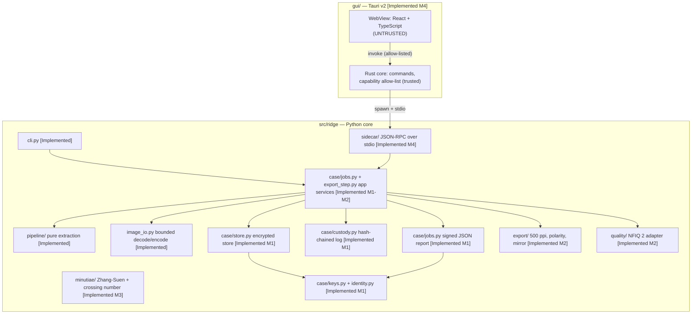
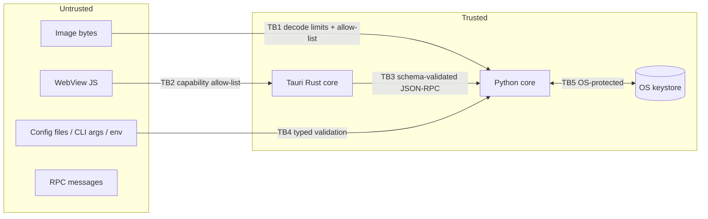

# Ridge — Architecture

| Field | Value |
| --- | --- |
| Document | `docs/architecture.md` (IEEE 1016-style design description) |
| Version | 0.2 (draft for owner review) |
| Date | 2026-10-18 |
| Status | Draft. §6, §7, §8 and §9 describe the implementation (M0–M4 engineering builds, including the desktop GUI in `gui/`). Packaging of the sidecar for release (§10) is still planned. |
| Requirements | [`docs/prd.md`](prd.md) (IDs FR-, SEC-, PRIV-, NFR-) |
| Standards | [`Instruction_documentation/Project_Standards_Profile.md`](../Instruction_documentation/Project_Standards_Profile.md) |

Each section is marked **[Implemented]** (in the repository now) or **[Planned]** (design target).

---

## 1. Context



Ridge has **no network interface**: no AFIS connection, no updates, no telemetry (SEC-1). The only exchange with the outside world is files: evidence imported by the examiner, and exports and reports written deliberately and logged.

## 2. Architectural drivers

| Driver | Source | Architectural consequence |
| --- | --- | --- |
| Evidence integrity, custody, reproducibility | FR-21–FR-25, G-2, G-3 | Content-addressed evidence, hash-chained custody log, signed reports, pinned toolchain, deterministic pipeline. |
| Special-category biometric data | PRIV-1–3, SEC-3 | Encryption at rest with dual-factor key wrapping; a single controlled export path; minimisation. |
| Offline single-examiner workstation | A-1, A-2, SEC-1 | No server, no sockets; the OS account plus case passphrase is the access control; local files. |
| Cross-platform desktop (Win/Linux/macOS) | NFR-5 | Pure-Python core on wheels; Tauri for the GUI; paths via `pathlib`; CI on three OSes. |
| Existing validated-to-be algorithm | FR-1 | Behaviour-preserving refactor; golden characterization tests guard every change. |
| Maintainability under fast delivery | NFR-6, R-8 | Small typed modules, strict gates, explicit dependency rules between layers. |

## 3. Quality attribute scenarios

| ID | Attribute | Stimulus → response | Measure |
| --- | --- | --- | --- |
| QA-1 | Integrity | Someone edits a byte of an output, report or log entry → `ridge case verify` reports the exact artefact. | 100% of tamper fixtures detected. |
| QA-2 | Reproducibility | A defence expert re-runs a job from its report with the same release on the same OS and CPU architecture → identical output. | Hash-equal output (same OS and architecture). |
| QA-3 | Security | A crafted image (decompression bomb, wrong format, truncated) is imported → rejected before full decode, with bounded memory and a typed error. | No crash; peak memory below the limit plus a constant. |
| QA-4 | Confidentiality | A workstation disk is copied → no biometric plaintext is readable without the keystore entry and the passphrase. | Storage inspection test. |
| QA-5 | Isolation | Compromised GUI JavaScript tries to read arbitrary files or reach the network → blocked by the Tauri capability allow-list and CSP; the sidecar accepts only schema-valid RPCs. | IPC denial tests. |
| QA-6 | Maintainability | A new export format is added → only `export/` and the report schema change. | No pipeline or case-store change. |

## 4. Solution strategy

1. **Pure, deterministic core.** The pipeline is a set of pure functions over NumPy arrays: no I/O, no global state, no clock, no randomness.
2. **Hexagonal edges.** All I/O sits at the edges: decoding, encoding, filesystem, keystore, crypto, sidecar RPC. Each edge is a small adapter with strict validation.
3. **Evidence as content-addressed, append-only data.** Originals and derived artefacts are named by SHA-256, and every action is a custody-log entry. Nothing is updated in place.
4. **Trust boundaries made explicit.** Image bytes, RPC messages and the WebView are untrusted. The Python core and the Tauri Rust core are trusted.
5. **Defense in depth for biometrics.** OS full-disk encryption, plus case-store encryption, plus a single logged export path, plus no network.

## 5. Building blocks (container view)



## 6. Module structure and dependency rules [Implemented for M0 modules]

```text
src/ridge/
  __init__.py          Public API: extract_fingerprint, ExtractionResult, errors, __version__
  __main__.py          python -m ridge
  cli.py               Argument parsing and the per-file loop (thin)
  errors.py            Typed error hierarchy (RidgeError → InputError, ParameterError, OutputError, ExtractionError, …)
  image_io.py          Allow-listed, size-bounded decoding; atomic, no-overwrite encoding
  debug.py             Writing of debug images (intermediate arrays → files)
  pipeline/
    imgutil.py         masked_blur, disk, largest_component, fill_holes, remove_specks
    mask.py            finger_mask (skin colour, Lab a*, Otsu)
    period.py          estimate_period (local FFT)
    gabor.py           gabor_bank, ridge_orientation, oriented_filter
    quality.py         periodicity and print-region selection
    extract.py         extract_fingerprint orchestration → ExtractionResult
fingerprint_extract.py Backward-compatible shim (legacy CLI and legacy function signature)
tests/                 pytest; synthetic data generator; golden characterization arrays
tools/gate.py          Named quality gates (see §12)
```

Dependency rules (enforced by review now; an import-linter contract is planned):

| Module | May import | Must not import |
| --- | --- | --- |
| `pipeline/*` | `numpy`, `cv2`, `ridge.errors`, sibling pipeline modules | `image_io`, `cli`, filesystem, `PIL`, clock, randomness, network |
| `image_io` | `PIL`, `numpy`, `cv2` (encode only), `ridge.errors` | `pipeline`, `cli` |
| `debug` | `image_io`, `numpy`, `cv2` | `cli` |
| `cli` | everything above | — (nothing imports `cli`, except `__main__` and the shim) |
| `sidecar/*` [Implemented M4] | `ridge.case`, `ridge.image_io`, `ridge.errors` | sockets or any network module (offline test), `cli` |
| `minutiae/*` [Implemented M3] | `numpy`, `cv2`, `ridge.errors`, `ridge.pipeline.imgutil` | file I/O, `case`, `cli`; no matching of any kind |
| `export/*`, `quality/*` [Implemented M2] | `numpy`, `cv2`, `PIL` (PNG pHYs), `ridge.errors`, `ridge.pipeline` (result type only); `quality` runs one configured external tool (absolute path, argv list, no shell, timeout) | file I/O except the NFIQ 2 temporary copy in a caller-given folder; `case`, `cli` |
| `case/*` [Implemented M1-M2] (`crypto`, `keys`, `identity`, `custody`, `store`, `jobs`, `export_step`, `verify`, `dispose`, `reports`, `processing_record`, `compare`, `reproduce`, `listing`, `cli` with `cli_common`, `cli_records`, `cli_compare`) | `cryptography`, `argon2-cffi`, `keyring`, `rfc8785`, `ridge.errors`, `ridge.image_io`; `jobs` also `ridge.pipeline` | `cli` modules of other packages; nothing outside `case` imports `case.cli` |

Files are kept to about 300 lines or fewer, and functions do one job. Documentation is never imported by runtime code.

## 7. Runtime views

### 7.1 Extraction (M0, current CLI) [Implemented]

```mermaid
sequenceDiagram
  participant U as Examiner
  participant C as cli.py
  participant I as image_io
  participant P as pipeline.extract
  participant D as debug
  U->>C: ridge photo.jpg [-o dir] [options]
  C->>I: load_image(path, limits)
  I-->>C: BGR uint8 array (EXIF-oriented) or InputRejectedError/DecodeError
  C->>P: extract_fingerprint(bgr, params)
  P-->>C: ExtractionResult(image, period, found_finger, debug arrays?)
  opt --debug
    C->>D: write_debug(result, stem, outdir)
  end
  C->>I: save_image(out_path, image, overwrite=False) (atomic)
  C-->>U: one summary line per file; exit 0 / 1 (failures) / 2 (usage) / 3 (internal error)
```

### 7.2 Case job (M1) [Implemented; M2 export steps planned]

1. `ridge case open` unlocks the case DEK: the passphrase goes through Argon2id to produce a KEK, combined with the keystore device secret (§9.2).
2. The job loads the evidence blob by hash, decrypts and verifies it (AES-GCM tag plus SHA-256), then decodes it via `image_io` with limits.
3. The pipeline runs, then the export transforms (polarity, mirror, 500 ppi), then NFIQ 2 (optional).
4. Outputs are encrypted and stored content-addressed. The report is built (§8.3), canonicalised (RFC 8785 JCS) and signed (Ed25519).
5. Custody entries are appended for each step: `job.start`, `evidence.read`, `artefact.write`, `report.sign`, `job.end`. The chain head is signed at `job.end`.
6. Any failure aborts the job, writes a `job.failed` entry with its category, and leaves no partial artefacts (atomic rename).

Reading reports back (`src/ridge/case/reports.py`, PRD FR-28): jobs are listed from the verified custody log. A job id from the caller is only matched against ids in that log (a full UUID or a unique prefix of at least 8 characters), so it never reaches a file path unchecked. Before a report is shown or exported, three checks must pass. Its bytes must hash to the `report.sign` entry. Its signature must verify against the store's examiner identity. It must name its own job and case. Reads are logged as `report.read` and exports as `report.export`. An export is the exact canonical bytes plus a base64 detached signature (`<file>.sig`). `ridge-case check-report` verifies the pair without the store. It rejects reformatted JSON, any edit and, with `--key-id`, any other key. The key id still has to be matched out of band against the examiner's published identity, because a report carries its own public key.

Readable reports (`src/ridge/case/report_html.py`, added 2026-10-18): `ridge-case report CASE JOB --html PATH` and the GUI ("Save readable copy...") write an HTML page of a verified report for the case file or printing. Every value is escaped; the page's Content-Security-Policy allows no scripts, network, images or forms; it holds no images and names the SHA-256 of the signed JSON it renders. The page is not signed, says so, and points to `ridge-case check-report`. It lists the job's examiner notes from the custody log in their own section, marked as not part of the signed report. Reviewers without the case store can make readable copies too: `ridge-case check-report report.json --html report.html` and `ridge-case check-log record.json --html record.html` (`src/ridge/case/record_html.py`) verify the file first and render from the same bytes they verified; nothing is written for a file that fails, and an existing file is never replaced. The export is logged as `report.export` with `format: html`. The GUI's Records section also shows the custody log newest first, filtered by kind and paged (`log.entries`, read only).

Examiner notes (`src/ridge/case/notes.py`, PRD FR-29, ISO/IEC 17025 §7.5 technical records): `ridge-case note` and the GUI append an `examiner.note` custody entry with the text and, optionally, the job, the stored item or the note it corrects. The job and item must exist in the case, and a correction must name an earlier note. A correction keeps the corrected note's job or item; naming a different one is refused. Text is 1–2000 characters, line breaks and tabs allowed. Other control characters and the bidirectional overrides and isolates (U+202A–U+202E, U+2066–U+2069) are refused, so a note cannot display differently from what is stored. Notes are encrypted and hash-chained like every entry, so they appear in the processing record, and they are never edited or removed. Ridge stores the text as written and does not interpret it; reports signed before a note are not changed.

Reference images and comparison sheets (`src/ridge/case/compare.py`, PRD FR-52): NAFIS/AFIS candidate images are imported with role `reference` (folder `references/`), with the examiner's note on where they came from. They are hashed, encrypted and logged like evidence (`reference.import`), and jobs refuse them. `ridge-case compare` decodes one export and one reference (both reads logged). It resamples them to one resolution (default 500 ppi), adds a 10 mm scale bar and captions to each, and writes a grayscale PNG with pHYs, logged as `comparison.export` with all three hashes. The reference's resolution comes from its file or from the examiner, and it must lie between 250 and 2000 ppi; 72 or 96 ppi defaults are refused, never guessed. Nothing is aligned, matched or scored.

Reproduction check (`src/ridge/case/reproduce.py`, PRD FR-34, NFR-3): `ridge-case reproduce` loads a verified report and rebuilds the job parameters from it alone. It runs them as a new, normally logged and signed job on the same evidence, then compares every output by role, label and SHA-256. Identical outputs are deduplicated, not stored twice. The comparison and any environment changes (version, platform, CPU architecture, dependency versions) are logged as `job.reproduce` with result `ok` or `mismatch`, under a new signed head. Results are reproducible per OS and CPU architecture (ADR-009), so a mismatch with an architecture change is expected and reported, not hidden. The NFIQ 2 score is not an output file and is not compared.

Processing record (`src/ridge/case/processing_record.py`, PRD PRIV-3): `ridge-case log --to` first logs `log.export` (with the case id), then signs the custody head, and then writes every decrypted entry with the case id and the examiner's public key as readable JSON (`ridge.processing-record/1`). Every entry in the file is therefore covered by a signed head. `ridge-case check-log` recomputes the sequence and the hash links from the entries and verifies every signed head. It refuses a record that does not end with that signed `log.export`, which catches appended entries and stripped signatures. It also refuses a record whose case id differs from the one in the signed entry. Truncation after a signed head cannot be detected offline (R-5); the DPO compares the last entry with what the examiner reports.

Disclosure package (`src/ridge/case/package.py`, implemented 2026-10-18): `ridge-case package CASE --to NEW_FOLDER` (GUI → Records) creates the folder (an existing one is refused) and writes the signed processing record with its readable copy (`processing-record.html`), every signed report with its detached signature, a readable HTML copy of each report with the job's examiner notes (listed in the manifest; a copy without its signed report is refused), and `MANIFEST.json` (schema `ridge.package/1`: package id, case id, Ridge version, examiner key, every file's SHA-256 and size; RFC 8785 canonical) with `MANIFEST.json.sig`. It holds **no images**; reports name the hash of every image. `package.export` is logged with the package id and its job ids before the processing record is signed, so the record names its own package. `ridge-case check-package` verifies offline: the manifest signature and canonical form, every file, that no file was added or removed (only `processing-record.json` and `reports/<uuid>.json[.sig]` or `.html` are allowed), the processing record, every report signature, and that each report is the one whose hash the custody log signed. Swapping in another valid report fails even with a re-signed manifest.

Store backups (`src/ridge/case/backup.py`, added 2026-10-18): `ridge-case backup --store S --to NEW_FOLDER` copies every regular file of the encrypted store, in chunks, into a folder that must not exist, and writes `BACKUP-MANIFEST.json` (`ridge.store-backup/1`, every file's SHA-256 and size). Nothing is decrypted and no passphrase is needed. A store with a case open elsewhere or a disposal in progress is refused, and links are refused. `ridge-case check-backup` recomputes every hash and refuses added, missing or changed files. The manifest is not signed; tampering with case contents is caught inside each case by its custody chain and signatures. **A backup does not contain the OS-keystore device secret**: restoring on another account or machine needs that secret too, so the laboratory's backup procedure must cover it.

Key register (`src/ridge/case/key_register.py`, PRD OQ-9, added 2026-10-18): the laboratory keeps `ridge.key-register/1` (laboratory name; per key: key id, public key, holder, role `examiner` or `fqm`, `valid_from`, optional `valid_until` and `revoked`). `ridge-case register --check` validates it strictly. `check-report`, `check-log`, `check-head`, `check-package` and `limits --check` take `--register`: they name the holder and refuse a key that is not registered, is registered for another role, or was not valid or already revoked on the signing day. Ridge does not sign the register; its SHA-256 is printed so the reviewer can confirm the version. Signing times come from the signed files (the signer's clock), so a key used before its revocation could backdate; countersigned custody heads (OQ-8) close that gap. Keys reach the register through key cards (`src/ridge/case/key_card.py`): `ridge-case key-card --store S` (or `--fqm-key K`) `--holder NAME --to card.json` writes `ridge.key-card/1`, signed with the key itself. The signature proves possession of the private key, not identity, which the laboratory confirms in person. `ridge-case register-add --card card.json --register old.json --to new.json` checks the card and writes a new register version; the old file is never changed. OQ-9 itself (one key per examiner or per workstation) stays an organisational decision.

### 7.3 GUI ↔ sidecar (M4) [Implemented]

Implemented in `src/ridge/sidecar/` (`ridge-sidecar`, protocol `ridge.sidecar/1`):

| Method | Params (unknown fields refused) | Result |
| --- | --- | --- |
| `ridge.version` | – | Ridge and protocol versions |
| `session.unlock` | `store` (absolute), `case_id` (UUID), `passphrase` | Case reference, retention, hold. **Only the Rust core sends this**, from a native prompt, never from the WebView |
| `store.cases` | `store` (absolute) | Case ids, creation time and state (active, locked, erasing, disposed, invalid) from plaintext files only; nothing is decrypted |
| `identity.create` | `store` (absolute), `passphrase` | Key id and public key of the new examiner identity (first run). **Rust core only**, from a native prompt |
| `store.backup` | `store` (absolute), `dest` (absolute, a new folder named in a native dialog) | Encrypted byte copy of the store with `BACKUP-MANIFEST.json`; nothing decrypted, no passphrase; refused while a case is open |
| `files.check` | `path` (absolute, from a native dialog; a folder is a package), `register` (optional) | Verifies an exported report, processing record, custody head, key card, key register, limits file or disclosure package with the CLI's verifiers; names the signer from a key register. No store needed, nothing written |
| `identity.card` | `store` (absolute), `passphrase`, `holder`, `dest` (absolute, from a native dialog) | Writes a self-signed key card (`ridge.key-card/1`) for the laboratory's key register. **Rust core only**, from the prompt window |
| `case.create` | `store`, `reference`, `legal_basis`, `retention_until` (YYYY-MM-DD), `passphrase` | New case id; the passphrase must unlock the identity. **Rust core only** |
| `store.identity` | `store` (absolute) | Whether the store has an examiner identity, and its key id and public key (nothing unlocked); first-run detection |
| `store.verify` | `store` (absolute), `passphrase` | Every case of the store verified as `case.verify` does (each check logged in that case's custody log); cases that cannot be checked are named, and a case open in another window counts as a problem (the check is incomplete). **Rust core only**, from the prompt window |
| `store.overview` | `store` (absolute), `passphrase` | Every case's reference, retention date, legal hold, evidence and job counts, read from the encrypted case metadata. Nothing is written or logged (no evidence is read). **Rust core only**, from the prompt window |
| `store.limits` | `store` (absolute) | The store's limits of use (§8.3): `configured: false`, or source, file SHA-256 and limits; a malformed file is refused |
| `session.lock` / `session.status` | – | Locks the case (also done at end of input and after 15 minutes without requests) / unlocked state and idle timeout |
| `case.status` | – | One-screen summary of the unlocked case: stored items by role, jobs by outcome, signed reports, notes, retention and hold, last verification and custody-head export (reads only) |
| `case.info` / `case.hold` | – / `on`, `reason` | Decrypted case metadata / places or lifts a legal hold with a reason (logged as `case.hold`) |
| `case.items` / `case.verify` | – | Stored items / verification result |
| `note.add` / `notes.list` | `text`, `job_id`, `sha256`, `corrects` / `job_id` | Appends an examiner note (custody action `examiner.note`; FR-29) / the notes of the case or one job. A note never changes; a correction names the note it corrects |
| `case.import` | `path` (absolute, from a native file dialog) | Evidence item |
| `job.run` | `evidence`, extraction options, `export`, `mirror`, `ppi`, `ruler`, `minutiae` | Outputs, measurements, export, quality, minutiae summary |
| `preview.get` | `sha256`, `max_side` 16–2048 | Bounded PNG (base64) for display, with the full image's size after EXIF orientation (`source_width`, `source_height`: the space of `roi` and `ruler`); the read is logged |
| `preview.region` | `sha256`, `x`, `y`, `width`, `height` (1–2048 px per side) | A full-resolution rectangle, unscaled and clipped to the image, for pixel inspection; the read is logged |
| `minutiae.get` | `sha256` (a minutiae item) | The job's minutiae in print and export pixels, with the "unvalidated" label, for the GUI overlay; the read is logged |
| `case.export` | `sha256`, `dest` (absolute), `overwrite` | Logged plaintext export |
| `case.jobs` | – | Jobs from the custody log: id, evidence, start and end time, result, whether a signed report exists |
| `report.get` | `job_id` (UUID or a unique prefix of 8 or more characters) | The report, returned only after its hash and signature are verified; the read is logged |
| `report.export` | `job_id`, `dest` (absolute), `overwrite` | Logged export of the canonical report and its detached signature (`dest.sig`) |
| `job.reproduce` | `job_id` | Re-run from the verified report; per-output comparison and environment changes (logged, signed) |
| `report.export_html` | `job_id`, `dest` (absolute), `overwrite` | Readable HTML rendering of a verified report: escaped values, a CSP with no scripts or embedded content, no images, the SHA-256 of the signed JSON in the footer; not signed (logged as `report.export`, `format: html`) |
| `log.entries` | `offset`, `limit` 1–500, `action` (a kind such as `job` or `examiner.note`) | A page of the custody log, newest first, and the total; read only |
| `log.export` | `dest` (absolute), `overwrite` | Logged, signed processing record (PRIV-3) |
| `head.export` | `dest` (absolute), `overwrite` | Logged, signed custody head for out-of-band countersigning (§8.4) |
| `package.export` | `dest` (absolute, a new folder named in a native dialog) | Disclosure package: processing record, signed reports, signed manifest; no images (logged) |
| `case.import_reference` | `path` (absolute), `source` | Reference item (NAFIS/AFIS candidate; view only, never processed) |
| `compare.export` | `export`, `reference`, `dest` (absolute), `reference_ppi`, `ppi`, `overwrite` | Logged equal-scale side-by-side sheet (FR-52) |

Errors use JSON-RPC codes: -32700 parse, -32600 invalid request, -32601 unknown method, -32602 invalid params, -32000 refused by Ridge (safe message), -32001 an input file refused (wrong format, too large, undecodable; a batch import may go on, every other refusal ends it), -32603 internal (exception type only).

- The Tauri Rust core spawns the frozen Python sidecar (`ridge-sidecar`, PyInstaller one-folder build, signed) as a child process. There are **no ports**.
- The protocol is JSON-RPC 2.0, one message per line, UTF-8, ECMA-404 JSON. Each message is at most 1 MiB. Images are passed by case-store reference, never inline; previews are bounded base64 PNGs.
- Each method has a strict schema (unknown fields rejected), an explicit allow-list of methods, and per-method size and time limits. The sidecar exits when stdin closes.
- The WebView can only call allow-listed Tauri commands, which forward validated requests to the sidecar. It has no `fs`, `shell` or `http` capabilities.

The sidecar methods live in `store_methods.py`, `case_methods.py` and `job_methods.py`; `handlers.py` is only the allow-list and the schemas.

**Desktop GUI (`gui/`).**

The **Rust core** (`gui/src-tauri/src`, trusted, `#![forbid(unsafe_code)]` through the crate lints) does the following:

- Process and transport (`sidecar.rs`, `rpc.rs`):
  - spawns the sidecar. Debug builds use the repository virtualenv, a path fixed at compile time. Release builds use `resources/sidecar/` only, never `PATH`, the working directory or user input;
  - removes the `PYTHON*` variables and `PYTHON_KEYRING_BACKEND` from its environment;
  - reads response lines of at most 32 MiB on a reader thread, with per-method timeouts of 30 s to 20 min;
  - on a timeout, a transport failure or a protocol violation, stops the sidecar (the case locks). The next call restarts it, at most three times per run. A failed request is never resent.
  - enforces the idle lock itself: a watchdog thread sends `session.lock` once 15 minutes pass without a request (`Sidecar::lock_if_idle`). The sidecar checks its own deadline only when a request arrives, and the WebView's timers may not run while the window is minimised or suspended.
- Commands (`commands/`): 27 thin commands; the list in `commands/list.rs` is shared by `build.rs` (ACL manifest) and the capability tests. Each command:
  - deserialises a `deny_unknown_fields` request;
  - validates every value: SHA-256 handles, UUIDs, free text, dates, numeric ranges;
  - maps to one sidecar method.
- Dialogs: native open, save and folder dialogs are opened by Rust (`dialogs.rs`, `tauri-plugin-dialog` with no WebView permission), so the WebView never sends a path. Exports never overwrite: the sidecar refuses an existing file.
- Passphrase prompt (`prompt.rs`, ADR-010): a separate window with its own page and capability. The passphrase goes from it to Rust to the sidecar, never to the main window.
- Settings: the last chosen store is remembered in the app config folder by Rust (`settings.rs`), never in WebView storage.
- Window lock-down (`windows.rs`, `tauri.conf.json`):
  - navigation is limited to the app origin and new windows are denied;
  - the CSP refuses inline and remote code, workers, frames and objects;
  - the asset protocol is off, `freezePrototype` is on, and `withGlobalTauri` is off;
  - one capability file per window;
  - release builds remove the WebView2 and WebKit inspector environment variables (`WEBVIEW2_ADDITIONAL_BROWSER_ARGUMENTS`, `WEBKIT_INSPECTOR_SERVER` and others, `lib.rs`) before any window exists. Otherwise a same-user process could start Ridge with a DevTools port and drive the IPC of an unlocked case. This was found in the release smoke test on 2026-10-18 and verified fixed.

The **WebView** (`gui/src`, untrusted, React and TypeScript with Motion) has these screens:

- the store screen: choose a store, first-run identity, case list, new case;
- the case screen, with these sections:
  - **Evidence**: import with a source note, then side-by-side review. Exhibit labels show the role and SHA-256, "Processed image - not an identification" on outputs, and a millimetre scale bar drawn at the current zoom with its method and uncertainty. The viewer has keyboard zoom and pan, stated zoom and interpolation, nearest neighbour when magnified, and full-resolution detail on request. Region and ruler tools have typed alternatives. Every job parameter is visible;
  - **Jobs**: verified reports, report export, reproduction;
  - **References**: view-only comparison and sheet export;
  - **Records**: verify, processing record, legal hold.

Previews are in-memory `blob:` URLs and are revoked when the case closes. A refusal that says the case is no longer unlocked (idle lock, sidecar restart) returns the examiner to the store screen. The GUI never polls the sidecar, so the 15-minute idle lock still works.

Added 2026-10-18: keyboard shortcuts in a case (`?` lists them; Alt+1–4 switch sections; the viewer keeps `+`, `-`, `0`, `1` and the arrow keys), never while the examiner types in a field. The case screen says when the retention date has passed without a legal hold, and the store screen can show every case's reference, retention date and hold after the passphrase prompt (`store_overview`). A report's viewer has a view-only Measure tool: two clicked points give their distance in pixels, and in millimetres only on the comparison export, whose resolution the report records, together with the scale's method and uncertainty; nothing is recorded or logged. The store screen has "Check exported files" for reviewers, the DPO and the FQM: a file or package folder is chosen in a native dialog (and optionally a key register), and the result says what was verified and who signed it (`src/ridge/case/file_check.py`). A job's report can be compared with another job's: the GUI reads both verified reports (each read logged) and lists the settings, input and Ridge version that differ, without ranking the outputs. Examiner notes (FR-29) are shown on each report and in Records. Several evidence photos can be imported from one native dialog (at most 50): the Rust core imports them one by one, each a logged `case.import`. Only a refusal of the photo itself (code -32001) lets the batch go on; a locked case, a custody or storage failure, or a stopped engine ends it. Notes can also be kept on an evidence photo.

A development preview (`gui/src/dev/preview.ts`: mocked IPC and synthetic drawn images) runs only under `npm run dev` outside Tauri. The GUI gate checks that it is absent from production builds.

## 8. Data architecture [Implemented M1]

### 8.1 Case store layout

```text
<store_root>/                       examiner-chosen, on an FDE-protected volume
  identity.json                     examiner Ed25519 public key + sealed private key (§9.3)
  limits-of-use.json                optional, placed by the Forensic Quality Manager: limits from the validation report (§8.3); no personal data
  limits-of-use.json.sig            optional: the FQM's Ed25519 signature over it (ridge.limits-signature/1, §8.3)
  <case_uuid>.disposal.json         kept after disposal: no personal data (§8.2)
  <case_uuid>/
    case.json                       schema, case id, KDF parameters, salt, wrapped DEK (no plaintext keys, no personal data)
    meta.enc                        case reference, legal basis, retention date, legal hold (encrypted)
    evidence/<keyed-name>.enc       original evidence, encrypted; never rewritten
    artefacts/<keyed-name>.enc      derived outputs and debug images
    reports/<job_uuid>.json.enc     signed job report, encrypted (no pixels, but personal data by reference)
    reports/<job_uuid>.json.sig     detached Ed25519 signature over the plaintext canonical report
    custody.jsonl.enc               append-only hash-chained log; each line AES-GCM encrypted
    LOCK                            single-writer lock file
```

Writes are atomic and never replace existing blobs (`image_io.publish`). The custody log is the index of everything stored: listing, verification and export resolve items through it. Evidence and artefacts are identified by the SHA-256 of their **plaintext**, computed before encryption. On disk they are named `HMAC-SHA256(name_key, sha256)` with `name_key` derived from the case DEK, so file names do not reveal whether a known image is in a store, yet duplicates are still detected. Verification needs the case unlocked (OQ-13).

### 8.2 Encryption envelope

| Item | Choice |
| --- | --- |
| Cipher | AES-256-GCM (`cryptography.hazmat.primitives.ciphers.aead.AESGCM`), 96-bit random nonce per file, single-shot (files are bounded by FR-9). |
| Associated data | `ridge-blob-v1 \| case_id \| role \| plaintext sha256` for blobs, `ridge-custody-v1 \| case_id \| seq` per custody line, `ridge-dek-v1 \| case_id` for the wrapped key. A blob cannot be swapped between cases, roles or positions. |
| Format | `magic "RDG1" \| version \| nonce \| ciphertext+tag`. |
| DEK | 256-bit from `secrets.token_bytes`, one per case. |
| KEK | `HKDF-SHA256(Argon2id(passphrase, salt; t=3, m=256 MiB, p=4) ‖ device_secret, info="ridge-kek-v1\|<purpose>")`, purpose = `case\|<case_id>` or `identity`. Stored parameters are unauthenticated, so they are bounded both ways (t 3-10, m 64 MiB-1 GiB, p 1-16) before Argon2 runs. One examiner passphrase unlocks the identity and all of that examiner's cases (`init` checks this). |
| Sub-keys | HKDF from the DEK: `ridge-data-v1` (blobs, metadata, reports), `ridge-names-v1` (keyed file names), `ridge-custody-v1` (custody lines). |
| Device secret | 256-bit random, one per OS account, stored in the OS keystore via `keyring` (Windows Credential Locker / Keychain / Secret Service). |
| Recovery | **Not implemented**: without the passphrase and the OS account a case is unrecoverable. An optional sealed recovery key waits for the Security Owner's decision (OQ-12). |
| Disposal | `ridge-case dispose`: refused under legal hold or before the retention date (unless `--before-retention`); needs the case id typed back and a reason code from a fixed list. Order: (1) `case.json` becomes an `erasing` stub without the wrapped DEK (crypto-erasure), (2) the `<case_id>.disposal.json` record is published, (3) the folder is deleted; re-running finishes an interrupted disposal. The record holds the examiner's key id and the reason code, no names or free text. The device secret is shared by all cases of the account and is not deleted. |

There is no custom cryptography: only library AEAD, KDF and signature primitives, with parameters recorded in `case.json` and `identity.json`.

### 8.3 Job report (JSON, ECMA-404) — schema outline

```json
{
  "schema": "ridge.job-report/1",
  "job_id": "uuid",
  "case_id": "uuid",
  "case_reference": "string",
  "created_utc": "2026-10-16T19:12:00Z",
  "ridge": {"version": "0.2.0", "python": "3.13.5", "platform": "Windows-11-…", "machine": "AMD64",
            "dependencies": {"numpy": "…", "opencv": "…", "pillow": "…", "cryptography": "…"}},
  "input": {"sha256": "…", "label": "IMG_0042.HEIC", "format": "HEIF", "size_px": [3024, 4032],
            "source": "Exhibit 12, phone A"},   // size after EXIF orientation: the space of roi and ruler
  "parameters": {"period": null, "min_quality": 0.25, "flip": false, "crop": true, "debug": false,
                 "minutiae": false, "roi": [900, 400, 700, 1100],
                 "export": {"enabled": true, "mirror": true, "target_ppi": 500, "ruler": [12, 40, 812, 44, 40]}},
  "measurements": {"ridge_period_px": 17.9, "found_finger": true, "output_scale": 1.0},
  "export": {"produced": true, "sha256": "…", "ppi": 500, "factor": 0.98,
             "transforms": ["polarity:dark-ridges", "mirror:horizontal", "scale:500ppi:ruler"],
             "scale": {"method": "ruler", "px_per_mm": 20.0, "uncertainty_pct": 0.25}},
  "quality": {"nfiq2": {"computed": true, "score": 54, "version": "…", "label": "indicative only: …"}},
  "limits_of_use": {"configured": true, "source": "VR-2027-01", "sha256": "…", "limits": {"require_ruler": true},
                    "within": false, "warnings": ["the export scale comes from ridge-period; …"]},
  "outputs": [{"role": "print|debug|export", "label": "…", "sha256": "…", "size": 12345}],
  "custody_head": "head of the custody chain when the report was built",
  "signer": {"key_id": "…", "public_key": "base64 Ed25519"},
  "disclaimer": "Image enhancement only. Ridge does not identify anyone and draws no conclusions."
}
```

All timestamps are ISO 8601 UTC with a `Z` suffix. The report is canonicalised with RFC 8785 before signing. Without a ruler the scale is `ridge-period` (assumed 0.47 mm ridge distance, ±15 %, both to be validated, `assumed_ridge_period_mm` recorded). An impossible scale gives `"export": {"produced": false, "reason": …}` without failing the job; `--no-export` gives `null`. NFIQ 2 that is not configured or fails gives `{"computed": false, "reason": …}`.

**Limits of use (PRD §12 item 8, `src/ridge/case/limits.py`).** The Forensic Quality Manager can place `limits-of-use.json` (schema `ridge.limits-of-use/1`) in the store. It holds:

- the validation report it comes from (`source`);
- optionally, the CPU architectures it covers;
- a ridge period range in pixels;
- a maximum export scale uncertainty;
- a minimum NFIQ 2 score;
- whether a ruler is required, and whether a located finger is required.

Unknown fields, wrong types and inconsistent ranges are refused, and the file is limited to 64 KiB. Ridge ships no limits.

For each job:

- the file is loaded before the job starts, and a malformed file stops it before anything is logged (fail closed);
- its SHA-256 is recorded in `job.start`;
- the report's `limits_of_use` section is either `configured: false`, or the source, the hash, the limits, `within` and plain-language warnings.

A job outside the limits is **not refused**: the examiner decides, informed. Reports made before this section existed have no `limits_of_use`. `ridge-case limits --check FILE` validates a file before it is deployed.

**Signed limits (`src/ridge/case/limits_signing.py`, implemented 2026-10-18).** The FQM creates a signing key once with `ridge-case fqm-key --to fqm-key.json`. The file holds an Ed25519 key sealed with AES-256-GCM under an Argon2id key from the FQM passphrase alone, so it works on the FQM's own machine and stays off examiner workstations. `ridge-case limits --sign limits-of-use.json --key fqm-key.json` validates the file and writes `limits-of-use.json.sig` (schema `ridge.limits-signature/1`: key id, public key, the file's SHA-256 and an Ed25519 signature over a domain prefix plus the exact bytes). When the store holds a signature, every job and `store.limits` verify it. A changed file, a changed or foreign signature, or a signature without its file stops jobs (fail closed); the report's `limits_of_use.signed_by` names the key id and public key, or is `null` for an unsigned file. As with examiner keys, anyone can make a key: a reviewer matches the key id against the laboratory's register out of band (`ridge-case limits --check FILE --key-id ID`). Deleting the signature is possible for anyone who can write the store, and the report then says `signed_by: null`.

### 8.4 Custody log entry

```json
{"seq": 42, "prev": "sha256(prev entry canonical bytes)", "ts_utc": "2026-10-16T19:12:03Z",
 "actor": "os-user@workstation-id", "action": "artefact.write",
 "target": {"sha256": "…", "role": "export"}, "job_id": "uuid", "result": "ok"}
```

`seq` is strictly increasing and `prev` links the chain. The chain head is signed at the end of each job and on `verify`. Clock trust is limited offline. Ridge never contacts a timestamp server itself.

**Custody heads for out-of-band countersigning (OQ-8, R-5; `src/ridge/case/custody_head.py`, implemented 2026-10-18).** `ridge-case head --to head.json` (or GUI → Records) logs `head.export`, signs the current head and writes a small file, schema `ridge.custody-head/1`. The file holds the case id, the sequence number, the chain hash, the times, the key and its public part. Two signatures cover it:

- the log's own `chain.sign` signature over the head hash;
- a second signature over the whole file.

The file holds no images and no personal data. The laboratory can countersign or timestamp it in its own systems. `ridge-case check-head head.json --record record.json` verifies the file and requires that a later processing record contains exactly that `chain.sign` entry at that sequence number. A log that was truncated after the head and continued fails this check, although its chain is internally consistent and the record alone would pass. Whether a lab system will countersign heads is still the Security Owner's decision (OQ-8).

## 9. Security architecture

### 9.1 Input handling [Implemented M0]

| Control | Implementation | Requirement / weakness |
| --- | --- | --- |
| Format allow-list by content | `PIL.Image.open(fp, formats=ALLOWED)`. Exotic plugins (EPS/Ghostscript, PSD, …) are never reached; the extension is ignored. | FR-8; CWE-434, CWE-20 |
| Bounded reading | Open with `O_NONBLOCK` (no hang on FIFOs); `fstat` regular-file and size check; capped read of at most `max_bytes + 1`; decode from memory; hard caps that configuration cannot exceed; minimum side 32 px. | FR-9; CWE-400, CWE-770 |
| Decompression-bomb guard | Header dimensions checked against `max_pixels` before `load()`; `Image.MAX_IMAGE_PIXELS` set to the limit; Pillow bomb warnings escalated to errors. | FR-9; CWE-409 |
| Single decoder, explicit errors | No fallback to a second decoder; truncated or corrupt input raises `DecodeError`. | FR-10; CWE-390, CWE-755 |
| Metadata stripping | Outputs are encoded from pixel arrays only; EXIF orientation is applied, then discarded. | FR-12 |
| Safe output writing | Private temporary file in the target folder and `fsync`, then publish with `os.link`, which fails atomically if the target exists (no check-then-write race). File systems without hard links fall back to exclusive create (`open("xb")`). `os.replace` only with `--overwrite`; temporary files always removed; POSIX modes `0o700` (dirs) and `0o600` (files). | FR-11; CWE-367, CWE-732 |
| Directory traversal | Folder mode lists regular files only and skips symlinks, reporting every skipped file; output names derive from `Path.stem` (no separators). | CWE-22, CWE-59 |
| Pipeline memory bounds | Library arguments validated (`ParameterError`); finger regions under ~75 px refused; the period-measurement rescale capped at 16 MP; work areas above 40 MP refused (`WorkAreaTooLargeError`). v0 could try to allocate many GiB for a thin skin blob. | FR-13; CWE-789, CWE-400 |
| Headless OpenCV | `opencv-python-headless`: no GUI/highgui backends in the dependency tree. | Attack-surface reduction |

### 9.2 Trust boundaries and threat model (STRIDE)



| Threat (STRIDE) | Example | Mitigation | Verification |
| --- | --- | --- | --- |
| Spoofing | Another OS user opens the case store | Keys need both the OS-keystore secret (per OS user) and the passphrase | Key tests; access test with another user (manual) |
| Tampering | Edited output, report or log | Content addressing, AES-GCM tags, hash chain, Ed25519 signatures, `verify` | Tamper fixtures (QA-1) |
| Repudiation | "That job was never run like that" | Custody log with actor, parameters, versions; signed reports | Report schema tests |
| Information disclosure | Plaintext biometrics on disk, in logs or temp files | Encryption at rest, single export path, no temp plaintext, log redaction, metadata stripping | Storage inspection, log tests |
| Denial of service | Decompression bomb, huge RPC payloads | Size and pixel limits, RPC size and time limits | Hostile-input tests (QA-3) |
| Elevation of privilege | WebView XSS calling file/shell APIs; malicious decoder plugin | No `fs`/`shell`/`http` capabilities, strict CSP, decoder allow-list, headless OpenCV | IPC denial tests; config review |

The full ASVS 5.0 L3 mapping (applicable chapters only, with N/A rationale for server-only chapters) is kept in the standards profile.

### 9.3 Key and signing management [Implemented M1]

- The signing key is Ed25519, one per store (`ridge-case identity init`), i.e. per examiner workstation until OQ-9 decides otherwise. The private key is sealed under an identity KEK (passphrase + device secret, purpose `identity`); `ridge-case identity show` prints the key id and public key for the lab registry. Reports and custody heads are verified against the store's identity key.
- Rotation: new reports use the new key, and old reports remain verifiable with registered old public keys.
- Passphrase policy follows the NIST SP 800-63B approach: at least 15 characters, checked against a breached-password list where available offline, with no composition rules. Argon2id parameters are recorded per case.

### 9.4 Supply chain

- Dependencies are pinned with hashes (`requirements.lock`, `requirements-dev.lock`, pip-tools). Installs use `--require-hashes`.
- Runtime dependencies are minimal: `numpy`, `opencv-python-headless` and `pillow` (plus `pillow-heif` as an extra). M1 adds `cryptography`, `argon2-cffi` and `keyring`.
- CI runs `pip-audit`, a licence allow-list, a CycloneDX SBOM, CodeQL, gitleaks, dependency review and OpenSSF Scorecard. Actions are pinned by commit SHA.
- Releases (M5) are built only from signed tags, produce signed artifacts, and are installed offline after signature verification.

## 10. Deployment view

| Release | Artifact | Install |
| --- | --- | --- |
| M0–M3 | Python wheel + hashed lock file | Offline: `pip install --no-index --require-hashes -r requirements.lock` from a vetted wheelhouse, then `pip install --no-deps ridge-*.whl`. |
| M4+ | Tauri bundle (MSI / DMG / AppImage) with the signed PyInstaller sidecar | Signed installer; Tauri updater disabled (offline only). |

Packaging the GUI release (implemented 2026-10-18, bundle build not yet exercised):

1. `tools/build_sidecar.py` freezes `ridge-sidecar` with PyInstaller 6.22.3 into a one-folder build (`build/sidecar/ridge-sidecar/`). PyInstaller is pinned with hashes in `requirements-build.lock`, which development and pull-request CI never install.
2. It checks that this platform's OS keystore backend is in the frozen archive.
3. It smoke-tests the frozen sidecar over stdio: protocol version, then an empty synthetic store.
4. `tauri build --config src-tauri/tauri.release.conf.json` turns the bundle on and ships the folder as `resources/sidecar/`. The default configuration stays bundle-off, so development builds never need a frozen sidecar.
5. A release build of the Rust core looks for the sidecar in its resource folder only (`sidecar::locate`).
6. The frozen build is about 210 MB on Windows. It is not bit-reproducible (PyInstaller embeds build timestamps); the release records the SHA-256 of every shipped file instead.

The reference workstation is to be specified (OQ-11).

## 11. Cross-cutting concepts

- **Errors:** `RidgeError` subclasses with safe, actionable messages. The CLI exits 0 (all ok), 1 (some inputs failed), 2 (usage/config error) or 3 (internal error: a bug, reported per file while the batch continues). Stack traces appear only with `--verbose` and never contain biometric data.
- **Logging:** stdlib `logging`, structured key=value, ISO 8601 UTC timestamps. Logs record hashes, IDs and categories only, never pixel data, passphrases or keys (SEC-5).
- **Configuration:** CLI flags first, then a `RIDGE_*` environment variable or config file (validated, typed). Defaults are safe. Unknown keys are rejected.
- **Numerics:** the float32 pipeline follows IEEE 754 with no nondeterministic parallel reductions. Reproducibility and method validation are per (release, OS, CPU architecture) (NFR-3, ADR-009). Behaviour preservation is proven on every platform by running v0 from git history next to the package and requiring bit-identical results. Stored goldens exist per architecture family (`tests/golden/v0-x86_64.*`, `v0-arm64.*`). On the reference machine they must match exactly; on other CPUs of the same architecture, ≥ 99.9% of output pixels must agree, the ridge spacing to 1e-6 relative and debug images to within 1 grey level on average. Results are not compared across architectures for equality. Instead, the committed golden sets must stay inside a cross-architecture envelope (`tests/cross_arch.py`): same outcomes and finger detection, ridge spacing within 1%, output size within 2 px, ≥ 99.8% of output pixels agreeing where the sizes match. The envelope is the difference measured on 2026-10-17 plus a small margin; widening it needs Forensic Quality Manager approval. `python tools/compare_goldens.py` prints the table for the release handoff.
- **Text and paths:** Unicode paths everywhere (`pathlib`, `np.fromfile`/`tofile` for OpenCV I/O); UTF-8 JSON.
- **Time:** UTC everywhere, ISO 8601 with `Z`. No local time in records.

## 12. Verification architecture

| Gate | Command | Applies |
| --- | --- | --- |
| docs | `python tools/gate.py docs` | Required documents exist; AGENTS.md reading order resolves; handoffs consecutive; no runtime import of docs |
| lint / format | `python tools/gate.py lint` / `format` | ruff (incl. bandit "S", bugbear "B" and others) |
| typecheck | `python tools/gate.py typecheck` | mypy `--strict` on `src/` and `tests/` |
| test | `python tools/gate.py test` | pytest with branch coverage ≥ 90% on `ridge` |
| sast | `python tools/gate.py sast` | bandit on `src/` |
| deps | `python tools/gate.py deps` | pip-audit on the hashed lock |
| secrets | `python tools/gate.py secrets` | gitleaks |
| licenses | `python tools/gate.py licenses` | pip-licenses allow-list |
| sbom | `python tools/gate.py sbom` | CycloneDX JSON |
| all | `python tools/gate.py all` | All of the above, fails on first error |

Test layers: characterization (live v0 run, bit-identical on every platform; per-architecture golden arrays), unit (pipeline helpers, I/O limits), hostile input (bombs, truncation, wrong formats, symlinks), CLI behaviour, offline guarantee (socket blocking), and, from M1, crypto, custody and tamper tests. From M2: report schema and determinism. From M4: GUI unit/E2E and IPC denial. Validation benchmarks run outside CI on the consented dataset (PRD §12).

## 13. Architecture decision records

| ADR | Decision | Status | Rationale (short) |
| --- | --- | --- | --- |
| ADR-001 | Offline-only: no network code in any component | Accepted | Biometric data, evidential use, workstation threat model (SEC-1). |
| ADR-002 | Python core; Tauri v2 + React + TypeScript GUI talking to a Python sidecar over stdio JSON-RPC | Accepted | Keeps the existing algorithm; rich UI; no listening sockets; WebView isolated. |
| ADR-003 | Pillow as the sole decoder with a format allow-list; headless OpenCV for processing only | Accepted | Removes decoder fallback and the exotic-plugin attack surface. |
| ADR-004 | Per-case AES-256-GCM DEK wrapped by keystore secret + Argon2id passphrase (HKDF-combined) | Accepted (implemented M1; Security Owner review pending) | Two factors, portable libraries, crypto-erase on disposal. Needs Security Owner approval. |
| ADR-005 | Content-addressed artefacts, hash-chained JSONL custody log, Ed25519-signed RFC 8785 reports | Accepted (implemented M1; Security Owner review pending) | Tamper evidence verifiable with standard tools. |
| ADR-006 | Hash-pinned locks, reproducible builds, release signing | Accepted | Reproducibility and supply-chain integrity. |
| ADR-007 | `src/` layout, pure pipeline, I/O at the edges, ≤ 300-line modules | Accepted | Testability and reviewability; pack modularity rules. |
| ADR-008 | Case store on the filesystem (files + JSONL) rather than SQLite, with keyed (HMAC) file names and all metadata, reports and custody lines encrypted | Accepted (implemented M1; Security Owner review pending) | Fewer moving parts; no plaintext personal data or image hashes on disk. Revisit if querying needs grow. |
| ADR-009 | Reproducibility and validation are per CPU architecture; behaviour preservation is proven against a live v0 run; goldens are stored per architecture (arm64 generated on a CI Apple silicon runner by the `golden` workflow) | Accepted | x86-64 and arm64 SIMD floating point legitimately differ (R-7, observed 2026-10-17); equality would always fail, so a measured cross-architecture envelope guards against further drift instead. |
| ADR-010 | The passphrase is typed in a separate, Rust-owned prompt window with its own page and capability, never in the main WebView ([docs/adr/ADR-010-passphrase-prompt-window.md](adr/ADR-010-passphrase-prompt-window.md)) | Accepted for engineering builds; Security Owner review pending | Tauri has no password dialog; OS-native prompts need unsafe FFI or a shell helper per platform. |
| ADR-011 | Hand-written IPC types checked by tests; Tauri isolation pattern not adopted for now ([docs/adr/ADR-011-gui-ipc-types-and-isolation.md](adr/ADR-011-gui-ipc-types-and-isolation.md)) | Accepted | Rust and the sidecar validate every value; 27 small types do not justify a generator yet. |

ADRs move to individual files under `docs/adr/` when they need more than a table row.
