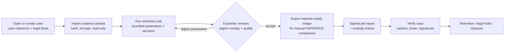

# Ridge — Product Requirements Document

| Field | Value |
| --- | --- |
| Document | `docs/prd.md` |
| Version | 0.12 (draft for owner review; M0-M4 implemented as engineering builds, including the desktop GUI, see `Instruction_documentation/Handoff/Handoff_15.md`) |
| Date | 2026-10-18 |
| Status | Draft. Not approved. Not approved for casework. |
| Product Owner | TBD (named owner required, see §17) |
| Related | [`docs/architecture.md`](architecture.md), [`Instruction_documentation/Project_Standards_Profile.md`](../Instruction_documentation/Project_Standards_Profile.md), [`AGENTS.md`](../AGENTS.md) |

Requirement keywords: **MUST** = mandatory for the milestone, **SHOULD** = expected unless an exception is recorded, **MAY** = optional. Priorities use MoSCoW (M/S/C/W).

---

## 1. Summary

Ridge turns ordinary digital photographs of fingers (for example, images recovered from a seized phone or supplied as case material) into clean fingerprint images that a qualified fingerprint examiner can compare against NAFIS/AFIS results.

Ridge is a **forensic image-enhancement aid**. It does not identify people, does not search databases, does not score matches for decisions, and never draws conclusions. All conclusions remain with the examiner under the lab's ACE-V procedure.

Because Ridge's outputs can become evidence, it must protect evidence integrity end to end. That means hashing everything, keeping an append-only chain-of-custody log, signing reports and producing reproducible results. It must also treat every fingerprint as special-category biometric data processed under the Law Enforcement Directive.

## 2. Problem statement

Photos of hands and fingers appear increasingly often in casework. Ridge detail in such photos is often present but obscured by lighting, focus fall-off, skin texture, compression and background clutter, and it is not in a form an examiner can compare with AFIS records. Manual enhancement in general-purpose image editors is slow, inconsistent between examiners, poorly documented and hard to defend in court.

The lab needs a tool that:

1. extracts ridge detail consistently and documents exactly how it did so;
2. never alters the original evidence;
3. produces outputs in a form suitable for manual comparison with NAFIS/AFIS results;
4. records a verifiable chain of custody and reproducible processing;
5. runs entirely offline on an examiner workstation.

## 3. Users and stakeholders

| Role | Description | Primary needs |
| --- | --- | --- |
| Fingerprint examiner (primary user) | Qualified examiner working one case at a time on an offline workstation; the only operator of a Ridge installation. | Fast, repeatable extraction; visible evidence of which area was used; exports for comparison; reports that hold up in court. |
| Forensic Quality Manager (ISO/IEC 17025) | Owns method validation and the lab's accreditation scope. | Validation evidence, version control, reproducibility, records. |
| Data Protection Officer | Owns the DPIA and legal basis under the LED transposition. | Data minimisation, retention, access control, auditability. |
| Security Owner | Owns workstation and application security. | Encryption, key custody, supply chain, vulnerability response. |
| Quality/Release Owner | Approves releases. | Gate evidence, signed artifacts, rollback. |
| Court / defence experts (indirect) | Review reports and may request reproduction. | Transparent method, reproducible results, intact custody. |

Out of scope as users: members of the public, data subjects, AFIS operators (Ridge does not integrate directly with AFIS).

## 4. Goals and non-goals

### 4.1 Goals

| ID | Goal | Measure |
| --- | --- | --- |
| G-1 | Usable ridge detail from typical case photos | Matcher benchmark (§12) meets the target agreed after the baseline run. |
| G-2 | Evidence integrity | 100% of inputs/outputs hashed; custody chain and signatures verify; originals never modified (tested). |
| G-3 | Reproducibility | Same input + same Ridge release + same OS and CPU architecture ⇒ bit-identical output; behaviour checked against a live v0 run on every CI platform (tested on every change). |
| G-4 | Lawful, minimal processing | DPIA approved; no network access; encrypted at rest; retention enforced per case. |
| G-5 | Defensible engineering | Quality gates green; OWASP ASVS 5.0 L3-mapped controls verified where applicable; zero open high/critical findings at release. |

### 4.2 Non-goals

- Ridge does not identify, search, match or rank candidates, and does not make any automated decision about a person.
- Ridge does not connect to NAFIS/AFIS or any network service.
- Ridge does not detect presentation attacks (spoofs); input photos are case material, not live captures.
- Ridge does not replace the examiner's comparison, the lab's ACE-V procedure, or ISO/IEC 17025 method validation.
- Ridge does not process latent prints lifted from surfaces in this release; this needs a separate validated method (possible future scope).
- No multi-user server, no cloud, no telemetry, no automatic online updates.

## 5. Legal, regulatory and standards context

All legal statements here are engineering assumptions **to be confirmed by the DPO and legal counsel** (see OQ-1 to OQ-3).

| Topic | Assumption | Consequence for Ridge |
| --- | --- | --- |
| Legal regime | Processing by a competent authority for the prevention, investigation, detection or prosecution of criminal offences: Directive (EU) 2016/680 (LED) as transposed in Slovenia (ZVOPOKD, to be confirmed). | Legal basis recorded per case (case reference required); purpose limitation; DPIA (LED Art. 27); logging of processing operations (LED Art. 25). |
| Data category | Fingerprints are biometric data and a special category (LED Art. 10); they cannot be revoked if leaked. | Strict necessity; encryption at rest; minimisation; retention per case; no copies outside the case store unless exported deliberately and logged. |
| EU AI Act (Reg. (EU) 2024/1689) | Ridge's extraction is deterministic signal processing with no identification function. It is assumed **not** to be an "AI system" under Art. 3(1). NFIQ 2 (M2) uses a trained model, and any ML-based minutiae extractor (M3) would too, so the assessment must cover them; reported 2026 amendments to the application dates must be checked. | Applicability assessment documented and signed off (OQ-3). Re-assess if any ML component is added. |
| ISO/IEC 17025 | The lab is or will be accredited; Ridge is part of a method that needs validation (7.2.2), records (7.5) and control of data and information management (7.11). | Validation study (§12), version control, reproducibility, records of every job. |
| ISO 21043 + ENFSI BPM | Forensic process (recognition → analysis → interpretation → reporting) and fingerprint best practice (ACE-V). | Ridge supports Analysis only; reports describe processing, not conclusions. |
| ISO/IEC 27037/27041/27042/27043 | Digital evidence handling and analysis methods must be validated, repeatable and documented. | Hashing, custody log, reproducibility, method documentation. |
| ISO/IEC 27001/27002:2022 | The organisation aligns with an ISMS. | Controls mapped in the standards profile. |
| Biometric standards | ISO/IEC 39794-4 / 19794-4 (finger image), 29794-4 (NFIQ 2), 39794-2 / 19794-2 (minutiae), ANSI/NIST-ITL 1-2025 (NIST SP 500-290e4; 1-2011 Update 2015 is still widely deployed), ISO/IEC 24745 (biometric information protection), ISO/IEC 19795 (performance testing). | Output and export formats, quality scoring and the benchmark method follow these standards. Exact AFIS exchange format is open (OQ-4). |
| Security | OWASP ASVS 5.0 Level 3 (applicable chapters), OWASP Top 10, CWE Top 25, NIST SP 800-218 SSDF. | Security requirements in §9; evidence in the standards profile. |

The full applicability matrix and editions are in [`Instruction_documentation/standards_applicability_and_compliance_matrix.md`](../Instruction_documentation/standards_applicability_and_compliance_matrix.md) and the [Project Standards Profile](../Instruction_documentation/Project_Standards_Profile.md).

## 6. Key workflow (as-is → to-be)

**Today (v0, R&D script):** `python fingerprint_extract.py photo.jpg` writes an unencrypted `photo_fingerprint.png` next to other files, with no case, hashing, report or custody record.

**Target workflow (M1–M2, CLI; M4, GUI):**

Every arrow that reads or writes evidence produces a custody-log entry.

## 7. Scope and milestones

The Product Owner set a one-week horizon with AI-assisted development in this repository. That is realistic for an **engineering MVP**. **Operational use on casework is a separate gate (M5)**: it requires a method validation study, an approved DPIA and owner approvals, and these cannot be compressed into a coding week.

| Milestone | Content | Target |
| --- | --- | --- |
| **M0 Foundation** | Instruction pack adopted; PRD and architecture; behaviour-preserving refactor into a typed package; input hardening; quality gates and CI. | Day 1 |
| **M1 Evidence integrity** | Encrypted case store, key custody, evidence import, hash-chained custody log, signed job reports, `verify`. **Implemented 2026-10-17** (`ridge-case`); recovery key open (OQ-12). | Days 2–3 |
| **M2 Matcher-ready output** | Polarity and mirror conversion, 500 ppi normalisation with scale calibration, lossless export, JSON job report, NFIQ 2 integration. **Implemented 2026-10-17** in `ridge-case extract`; ridge-period scale assumption and NFIQ 2 output format to be validated. | Day 4 |
| **M3 Minutiae & exchange** | Minutiae extraction; export in the confirmed AFIS exchange format (OQ-4). **Minutiae implemented 2026-10-17** (`ridge-case extract --minutiae`, Ridge JSON format); exchange formats wait for OQ-4. | After OQ-4 is answered |
| **M4 Desktop GUI** | Tauri v2 + React + TypeScript GUI over the Python sidecar: case view, side-by-side review, parameter tuning, export. **Python sidecar implemented 2026-10-17** (`ridge-sidecar`, JSON-RPC over stdio); **desktop GUI implemented 2026-10-18** (`gui/`, engineering build; release packaging of the sidecar, GUI E2E tests and the manual screen-reader pass are open). | Days 5–6 (skeleton); full GUI after M3 |
| **M5 Validation & approval** | Benchmark on the consented dataset, validation report, DPIA, AI Act assessment, owner sign-off, release v1.0. | Organisation timeline |

Day 7 is reserved for the security review, release candidate and handoff.

## 8. Functional requirements

### 8.1 Extraction (core) — existing behaviour, preserved in M0

| ID | Requirement | Pri. | MS | Acceptance criteria |
| --- | --- | --- | --- | --- |
| FR-1 | Ridge MUST extract ridges from a photo of a finger and output white ridges on black (current algorithm, unchanged). | M | M0 | Golden characterization tests: refactored output is pixel-identical to v0 on the reference platform. |
| FR-2 | Ridge MUST locate the finger by skin colour and fall back to the whole frame when skin and background do not separate, reporting which case applied. | M | M0 | Tests cover both paths; result exposes `found_finger`. |
| FR-3 | Ridge MUST estimate ridge spacing automatically and accept a manual override (`--period`). | M | M0 | Estimate within ±5% on synthetic fixtures with known spacing; override used verbatim. |
| FR-4 | Ridge MUST keep only regions with a real, repeating ridge pattern above `--min-quality` and leave blurry areas out rather than invent ridges. | M | M0 | Tests: noise-only input yields a "no ridge pattern" error, not an image. |
| FR-5 | Ridge MUST support `--flip`, `--no-crop` and `--debug` (region overlay, normalised, Gabor, quality images). | M | M0 | CLI tests per option. |
| FR-6 | Ridge MUST process single files and folders. In folder mode it MUST skip, and report on stderr, files named like its own outputs, symlinks and non-regular files. | M | M0 | CLI tests: own outputs and links in the folder are skipped with a message. |
| FR-7 | Ridge MUST be usable as a typed Python library (`ridge.extract_fingerprint`) and as a CLI (`ridge`, `python -m ridge`, legacy `fingerprint_extract.py`). | M | M0 | Import and entry-point tests; mypy strict passes. |

### 8.2 Input handling (hardening, M0)

| ID | Requirement | Pri. | MS | Acceptance criteria |
| --- | --- | --- | --- | --- |
| FR-8 | Ridge MUST decode only allow-listed formats (JPEG, PNG, TIFF, BMP, WebP, HEIF/HEIC with the optional extra), identified by content, not extension. | M | M0 | A file with a disallowed format (e.g. EPS, PSD, GIF) is rejected even when renamed `.jpg`. |
| FR-9 | Ridge MUST enforce configurable limits before full decoding: maximum file size (default 200 MiB, hard cap 1 GiB), maximum pixel count (default 150 MP, hard cap 170 MP) and minimum side (32 px). | M | M0 | Oversized-file, decompression-bomb-header and tiny-image fixtures are rejected before decoding with a typed error. |
| FR-10 | Ridge MUST report decoder failures explicitly (no silent fallback to another decoder). | M | M0 | Truncated/corrupt fixtures produce a typed `InputRejectedError`/`DecodeError` with a safe message and non-zero exit. |
| FR-11 | Ridge MUST NOT overwrite existing outputs unless `--overwrite` is given, and MUST publish outputs atomically with no check-then-write race. `--overwrite` MUST NOT be available for case-store artefacts (M1). | M | M0 | Re-run without `--overwrite` fails for that file; an interrupted write leaves no partial or temporary file. |
| FR-12 | Ridge MUST honour EXIF orientation and MUST NOT copy source metadata (EXIF/GPS/XMP) into outputs. | M | M0 | Test: outputs contain no metadata chunks from the source. |
| FR-13 | The pipeline MUST bound its memory use: refuse a finger region narrower than ~75 px (too small for resolvable ridges), cap the rescaling used to measure ridge spacing, and refuse work areas above 40 MP at working resolution. | M | M0 | Degenerate-mask and huge-work-area tests fail fast with typed errors. |

### 8.3 Case store and evidence integrity (M1)

| ID | Requirement | Pri. | MS | Acceptance criteria |
| --- | --- | --- | --- | --- |
| FR-20 | `ridge case init` MUST create a case with a case reference, legal-basis reference and retention date, refusing to start without them. | M | M1 | Missing fields → refusal; case metadata stored encrypted. |
| FR-21 | `ridge case import` MUST compute SHA-256 of each original, store it encrypted and read-only, and never modify it. | M | M1 | Hash recorded before encryption; decrypt-and-rehash round-trip matches; no API path writes to originals. An optional source note (exhibit number, device) is kept encrypted in the custody log and repeated in every job report on the photo (`ridge-case import --source`, added 2026-10-17). |
| FR-22 | Every read, import, job, export, verification and disposal MUST append an entry to the case's hash-chained custody log (actor, action, target hashes, parameters, ISO 8601 UTC timestamp, result). | M | M1 | Any edit, deletion or reordering of entries is detected by `ridge case verify`. |
| FR-23 | Each extraction job MUST produce a JSON job report (ECMA-404, schema-validated) and a detached Ed25519 signature. | M | M1 | Report validates against its schema; signature verifies; a one-byte change fails verification. |
| FR-24 | `ridge case verify` MUST check all hashes, the custody chain and all signatures, and report the first failure precisely. | M | M1 | Tamper fixtures for each artefact type are detected. |
| FR-25 | `ridge export` MUST be the only way to write decrypted outputs outside the case store, to an examiner-chosen location, with a custody entry. | M | M1 | No other command writes plaintext biometric outputs. |
| FR-26 | Ridge MUST support retention dates and legal hold, and MUST perform disposal only on explicit command with confirmation, logging it. | M | M1 | Disposal of a case on hold is refused; disposal removes keys (crypto-erase) and logs the event. |
| FR-27 | A legacy "no case" mode MAY remain for R&D on synthetic or consented data, clearly labelled "not for casework" in output and reports. | C | M1 | Warning printed; outputs carry no evidential report. |
| FR-28 | Ridge MUST let the examiner list a case's jobs and show or export a job's signed report only after checking it against the custody log and the examiner identity; an exported report (canonical bytes plus detached signature) MUST be verifiable offline without the case store. | M | M1 | `ridge-case jobs`, `ridge-case report` and `ridge-case check-report`; a one-byte change, a reformatted report or another key fails; reads and exports are logged. |

### 8.4 Matcher-ready output and quality (M2)

| ID | Requirement | Pri. | MS | Acceptance criteria |
| --- | --- | --- | --- | --- |
| FR-30 | Ridge MUST export comparison images as dark ridges on a light background, mirrored to match contact-impression orientation, with both conversions recorded in the report. | M | M2 | Tests confirm polarity and mirroring; report lists the transforms. |
| FR-31 | Ridge MUST normalise exports to 500 ppi using (a) a scale calibration from a ruler in the photo when available, else (b) the measured ridge period with a documented assumed inter-ridge distance, and MUST state which method was used and its uncertainty. | M | M2 | Report contains scale method, factor and uncertainty; calibrated fixtures land within ±2% of the target scale. |
| FR-32 | Ridge MUST export lossless 8-bit grayscale PNG (default) with the resolution recorded; other formats (e.g. WSQ, ANSI/NIST-ITL, ISO/IEC 39794-4) follow OQ-4. | M | M2 | Exported PNG carries a pHYs chunk at 500 ppi and no source metadata. |
| FR-33 | Ridge SHOULD compute an NFIQ 2 score (ISO/IEC 29794-4) per export using the NIST reference implementation and record its version. | S | M2 | Score and version appear in the report; missing tool → recorded "not computed", not a failure. |
| FR-34 | The job report MUST record: Ridge version and commit, dependency versions, platform, all parameters, measured ridge period, region statistics, input/output hashes, transforms and timestamps. | M | M2 | Schema test; reproduction from the report alone yields an identical output (`ridge-case reproduce` re-runs a signed job from its report and compares every output hash, implemented 2026-10-17). |
| FR-35 | Ridge SHOULD let the examiner restrict a job to a rectangle of the photo (for example one finger of several), recorded in the report and honoured by reproduction. **Proposed 2026-10-17 by engineering from the review-and-adjust loop in §6; product-owner confirmation pending.** | S | M2 | `--roi X Y W H` / sidecar `roi`; whole-photo ROI gives identical outputs; malformed ROIs are refused before a job starts; out-of-photo ROIs fail the job with a logged reason. |

### 8.5 Minutiae and exchange (M3)

| ID | Requirement | Pri. | MS | Acceptance criteria |
| --- | --- | --- | --- | --- |
| FR-40 | Ridge SHOULD extract minutiae (ridge endings, bifurcations; position, direction, quality) from accepted exports. | S | M3 | Benchmark against a reference extractor on synthetic and consented sets. GUI overlay implemented 2026-10-18: off by default, circles for endings and squares for bifurcations, on the print or the export, labelled "unvalidated, orientation only, never used for matching". |
| FR-41 | Ridge SHOULD export images/templates in the AFIS exchange format confirmed in OQ-4. | S | M3 | Conformance check against the chosen standard's test tools or vendor import. |

### 8.6 Desktop GUI (M4)

| ID | Requirement | Pri. | MS | Acceptance criteria |
| --- | --- | --- | --- | --- |
| FR-50 | The GUI MUST provide case open/create, evidence import, job run with parameters, side-by-side original/region/result review, export and verify. | M | M4 | E2E tests for each flow; denial paths (locked case, failed verify). Sidecar back end for every flow implemented 2026-10-17. GUI implemented 2026-10-18: store screen (choose store, first-run identity, cases, new case), passphrase prompt window (ADR-010), evidence import, side-by-side review with all job parameters, jobs with verified reports, export, verify, legal hold, processing record. Denial paths covered by tests: locked case returns to the store, verification failure shown as an alert. Tauri WebDriver E2E open (exception). |
| FR-51 | The GUI MUST support two-point scale calibration on a ruler visible in the photo. | M | M4 | Calibrated factor flows into FR-31. Implemented 2026-10-18: ruler points clicked on the photo or typed (photo pixels after EXIF orientation), distance in mm, sent as the job's `ruler`; the scale bar shows the calibrated scale and its uncertainty. |
| FR-52 | The GUI SHOULD show an imported NAFIS/AFIS candidate image beside the Ridge export for manual comparison (view only, no matching). | S | M4 | Imported image is hashed and logged like evidence. Back end implemented 2026-10-17: `ridge-case import-reference`, `ridge-case compare` (equal-scale sheet with 10 mm bars; resolution from the file or the examiner, never guessed), sidecar `case.import_reference` / `compare.export`. GUI implemented 2026-10-18 (References section: export and reference side by side, view only, sheet export). |
| FR-53 | The GUI MUST meet WCAG 2.2 AA for its controls and MUST respect `prefers-reduced-motion`. | M | M4 | Automated a11y checks plus a keyboard-only walkthrough. Implemented 2026-10-18: axe-core checks of the store, case and prompt screens in Vitest (no violations; colour contrast checked by token design, jsdom has no layout); keyboard-operable viewer, typed alternatives to dragging (SC 2.5.7), 24 px minimum targets, visible focus, `MotionConfig reducedMotion="user"`. Manual screen-reader pass (NVDA, VoiceOver) open. |

## 9. Security and privacy requirements

Mapped to OWASP ASVS 5.0 (applicable chapters for an offline desktop application), CWE and NIST SSDF in the [standards profile](../Instruction_documentation/Project_Standards_Profile.md).

| ID | Requirement | Pri. | MS | Verification |
| --- | --- | --- | --- | --- |
| SEC-1 | Ridge MUST make no network connections at runtime (core, sidecar and GUI). | M | M0 | Test that blocks sockets during full runs; GUI CSP `connect-src` restricted to IPC; dependency review. |
| SEC-2 | All untrusted input (images, JSON, RPC messages, config) MUST be validated against explicit limits and schemas before use. | M | M0–M4 | Malformed/oversized/fuzz tests per input type. |
| SEC-3 | Biometric data at rest MUST be encrypted with AES-256-GCM under a per-case key; keys MUST be wrapped by both the OS keystore and an examiner passphrase (Argon2id). | M | M1 | Crypto tests; storage inspection shows no plaintext; wrong passphrase / missing keystore entry → denial. |
| SEC-4 | Ridge MUST use only vetted cryptographic libraries (`cryptography`, `argon2-cffi`) with no custom primitives. | M | M1 | Code review; dependency list. |
| SEC-5 | Ridge MUST never log biometric content, passphrases, keys or full file contents; logs contain hashes and IDs only. | M | M0 | Log-redaction tests. |
| SEC-6 | Dependencies MUST be pinned with hashes, audited for known vulnerabilities and licences, and listed in an SBOM per release. | M | M0 | `deps`, `licenses`, `sbom` gates. |
| SEC-7 | Releases MUST be built reproducibly by CI from a tagged commit and signed; installation MUST verify the signature offline. | M | M5 | Release checklist evidence. |
| SEC-8 | The GUI WebView MUST be treated as untrusted: strict CSP, no remote content, Tauri capability allow-list, no shell access, IPC calls validated in the trusted layer. | M | M4 | Tauri config review; IPC denial tests. |
| SEC-9 | Ridge MUST fail closed: a failed integrity, key or schema check stops the operation and logs the failure category. | M | M1 | Failure-path tests. |
| SEC-10 | Static analysis, secret scanning and CodeQL MUST run in CI with zero unreviewed high/critical findings at release. | M | M0 | CI evidence. |
| PRIV-1 | Data minimisation: Ridge MUST process only the imported evidence and MUST NOT keep intermediate or debug images outside the case store. | M | M1 | Tests on temp-file usage; debug outputs are encrypted in the case store. |
| PRIV-2 | Retention and disposal per FR-26; crypto-erase on disposal. | M | M1 | See FR-26. |
| PRIV-3 | Processing records (LED Art. 25-style logging) MUST be exportable for the DPO. | S | M1 | `ridge-case log --to` produces a readable, signed record; `ridge-case check-log` verifies it without the case store (implemented 2026-10-17). |

## 10. Non-functional requirements (ISO/IEC 25010)

| ID | Characteristic | Requirement | Target / measure |
| --- | --- | --- | --- |
| NFR-1 | Performance efficiency | Extraction time per photo on the reference workstation. | Target p95 ≤ 20 s for a 12 MP phone photo; peak memory ≤ 4 GiB at the default limits. **Baseline 2026-10-17** (`tools/perf_benchmark.py`, development workstation: Intel x86-64, Windows 11, OpenCV 14 threads): 12 MP synthetic photo 4.6–8.5 s, peak traced memory ≈ 390 MiB; 48 MP 9.7 s, ≈ 700 MiB (traced NumPy allocations; resident size is higher). Repeat on the reference workstation (OQ-11). |
| NFR-2 | Reliability | No partial outputs or corrupted case state after crash or power loss. | Atomic writes; crash-injection tests on import/job/export. |
| NFR-3 | Reproducibility | Bit-identical output for identical input, release, OS and CPU architecture (x86-64, arm64). Results from different architectures legitimately differ (SIMD floating point). They must stay inside the documented cross-architecture envelope: same outcomes and finger detection, ridge spacing within 1%, output size within 2 px, and ≥ 99.8% of output pixels agreeing where the sizes match. They are reported per release and are **not interchangeable for casework** without validation of each architecture (§12). Requirement changed on 2026-10-17 at the product owner's direction (PR #1), replacing "≥ 99.9% cross-platform agreement". | Live v0 bit-identical test on every platform of the full CI matrix (every release) and on Apple silicon for pull requests that change pixel-affecting code; per-architecture goldens (`tests/golden/v0-<arch>.*`); envelope test `tests/test_cross_architecture.py`; report `python tools/compare_goldens.py` in the release handoff. |
| NFR-4 | Numerical correctness | IEEE 754 float32 pipeline; tolerances documented; no nondeterministic parallel reductions. | Golden tests; tolerance rationale in architecture §11. |
| NFR-5 | Portability | Windows 11, Linux (x86-64), macOS (Apple silicon); Python 3.12–3.14. Casework only on architectures covered by method validation (NFR-3, OQ-15). | Full CI matrix green on all three OSes and Python versions for every release; pull requests run Linux with Python 3.12 plus Apple silicon when pixel-affecting code changes; the full matrix runs on demand and for release tags (owner decision 2026-10-17 to minimise GitHub Actions usage). |
| NFR-6 | Maintainability | Source files ≤ ~300 lines; mypy strict; ruff clean; branch coverage ≥ 90% for `ridge` core. | `lint`, `typecheck`, `test` gates. |
| NFR-7 | Usability | Errors explain what failed and what to try next, with no stack traces for expected errors. | CLI message tests; GUI review. |
| NFR-8 | Accessibility | WCAG 2.2 AA in the GUI. | FR-53. |
| NFR-9 | Compatibility | Unicode file paths on all platforms; ISO 8601 UTC timestamps; ECMA-404 JSON. | Tests with non-ASCII paths; schema tests. |
| NFR-10 | Supportability | Each release has notes, an SBOM, a signed artifact and a handoff. | Release checklist. |

## 11. Data inventory and classification

| Data | Classification | Where it lives | Retention |
| --- | --- | --- | --- |
| Evidence photos (originals) | Biometric special category, evidential | Case store, encrypted, read-only | Per case retention / legal hold |
| Derived outputs (prints, debug, exports in store) | Biometric special category, evidential | Case store, encrypted | Per case |
| Exported files | Biometric special category | Examiner-chosen location (logged); lab policy governs | Lab policy (outside Ridge) |
| Job reports + signatures | Evidential record, personal data by reference | Case store | Per case; may outlive images if policy requires |
| Custody log | Evidential record | Case store | Per case; never edited |
| Case-store keys (wrapped), signing key | Secret | OS keystore + case store (wrapped only) | Until disposal / rotation |
| Synthetic test data | Non-personal | Repository | Indefinite |
| Consented validation dataset | Biometric special category (consented) | Outside the repository, access-controlled | Per consent terms |
| Application logs | Internal, no biometric content | Local log directory | 90 days default |

Real biometric images MUST NEVER be committed to git or used in CI (enforced by `.gitignore` and a docs/secret-scan gate).

## 12. Validation and success metrics

ISO/IEC 17025 7.2.2 method validation, run by the Forensic Quality Manager with engineering support:

1. **Dataset:** consented volunteers. Per finger: N phone photos under varied capture conditions plus contact-scanner reference prints at 500 ppi. Sample size and protocol are defined in the validation plan (OQ-6). Stored outside the repository.
2. **Benchmark (ISO/IEC 19795 method):** compare Ridge exports to the contact references with an open matcher (SourceAFIS or NIST NBIS Bozorth3). Report the DET curve, FNMR at FMR = 0.01% and 0.1%, and the failure-to-extract rate. Metrics are computed with `ridge-validate` (Ridge ≥ 0.2: FMR/FNMR at target FMRs with Wilson 95 % intervals and a rule-of-30 check, DET curve, EER, failure-to-extract rate, per-group breakdown for the bias check).
3. **Quality:** NFIQ 2 distribution of exports versus references.
4. **Targets:** provisional targets are FNMR ≤ 20% at FMR = 0.1% for photos meeting the capture guidance and a failure-to-extract rate ≤ 10%. They are to be **confirmed after the baseline run** (OQ-7), because published contactless-to-contact results vary widely with capture quality.
5. **Robustness:** compression levels, resolution, focus and lighting variation; mixed skin tones (bias check across skin tones is mandatory).
6. **Examiner study (recommended):** examiners rate usability of Ridge exports versus manual enhancement for a sample.
7. **Per architecture:** the study runs on every CPU architecture that will be used for casework (x86-64, arm64). Results on one architecture do not validate another (NFR-3).
8. **Outcome:** a validation report that defines the method's limits of use (e.g. minimum ridge spacing in pixels, minimum NFIQ 2) and enforces them in Ridge as warnings. **Mechanism implemented 2026-10-18** (architecture §8.3): the Forensic Quality Manager places `limits-of-use.json` in the store (source, architectures, ridge period range, maximum scale uncertainty, minimum NFIQ 2, ruler or located finger required). Every job report records the file's hash and any deviation as a warning, and the CLI and GUI show the warnings. No values are shipped: they come from the validation report.

Engineering success metrics for the MVP: all gates green on the 3-OS CI matrix; 0 open high/critical findings; characterization tests pass; `verify` detects 100% of tamper fixtures.

## 13. Assumptions and constraints

- A-1 Single examiner per workstation; the OS account plus case passphrase is the access control. A shared lab server is out of scope (it would trigger the multi-user rules in the pack).
- A-2 Workstations are lab-managed, with full-disk encryption and no internet access in production.
- A-3 Development and CI have internet access (dependency audit, CodeQL). Production releases are installed offline from signed artifacts.
- A-4 The examiner has photos as files; acquisition from phones (forensic extraction) happens upstream with its own tools and hashes, which Ridge records on import.
- A-5 The organisation can provide or collect a consented validation dataset.
- C-1 Python core (existing algorithm), Tauri v2 + React + TypeScript GUI (decided).
- C-2 Internal distribution only (no external licensing obligations beyond dependency licences).
- C-3 Timeline: engineering MVP in one week; casework approval separately (M5).

## 14. Risks

| ID | Risk | Likelihood | Impact | Mitigation |
| --- | --- | --- | --- | --- |
| R-1 | Ridge outputs over-trusted as identification evidence. | Medium | High | Non-goals stated in every report; examiner-in-the-loop; validation limits enforced as warnings. |
| R-2 | The algorithm invents ridge detail (artefacts) in poor regions. | Medium | High | Quality gating (FR-4); region overlay in reports; validation of false-detail rates; conservative default `--min-quality`. |
| R-3 | Scale (500 ppi) error when no ruler is present. | High | Medium | Calibration preferred (FR-31); uncertainty in report; validation of the period-based assumption. |
| R-4 | Biometric data leak from a workstation or export. | Low | Critical | Encryption at rest, offline operation, export logging, minimisation, crypto-erase. |
| R-5 | Custody record challenged in court (e.g. clock manipulation, no trusted timestamping offline). | Medium | High | Hash chain + signatures; monotonic sequence numbers; optional lab-side countersigning (OQ-8). |
| R-6 | Supply-chain compromise of a dependency or image decoder (e.g. libheif, libtiff). | Medium | High | Hash-pinned lock, audits, SBOM, minimal decoder allow-list, headless OpenCV, CI on tagged commits only. |
| R-7 | Cross-architecture numerical differences (x86-64 vs arm64). **Materialised 2026-10-17:** on Apple silicon one golden case agreed on 99.85% of output pixels and one measured ridge spacing differed by +0.5% (Handoff_2). | High (observed) | Medium | Reproducibility and validation per architecture (NFR-3, §12); casework workstations limited to validated architectures (OQ-15); cross-architecture deltas reported per release. |
| R-8 | One-week timeline pressure reduces rigour. | High | High | Gates are blocking; behaviour-preserving refactor first; M5 is separate; open items tracked in handoffs. |
| R-9 | Legal basis or DPIA not approved. | Medium | Critical | DPO engaged before M5; no casework use before approval. |
| R-10 | Owners not named, so approvals stall. | High | High | Owner roles are a release blocker in the standards profile. |
| R-11 | Performance problems on large photos. | Medium | Medium | Baseline in M0; pixel limits; optimisation after correctness. |
| R-12 | `pillow-heif` wheels bundle GPL (x265) and LGPL (libheif, libde265) code, and native HEIF decoders have a CVE history. | Medium | Medium | Internal use only; legal review; evaluate decoder-only `pi-heif` (OQ-14); HEIF stays behind the format allow-list. |

## 15. Open questions

| ID | Question | Owner | Needed by |
| --- | --- | --- | --- |
| OQ-1 | Confirm the legal basis and instrument (LED transposition, act name and articles) for processing fingerprints from case photos. | DPO / legal | M5 |
| OQ-2 | DPIA: who drafts and approves it, and what retention periods apply per case type? | DPO | M1 (retention defaults), M5 |
| OQ-3 | Confirm the EU AI Act assessment for Ridge's extraction, for NFIQ 2 (trained model) and for any ML minutiae extractor, including the 2026 amendments. | Legal | M5 |
| OQ-4 | Which exchange format and resolution do your NAFIS/AFIS workflows accept for manual comparison or search (e.g. 500 ppi PNG/WSQ, ANSI/NIST-ITL Type-14/13, ISO/IEC 39794-4), which vendor/system, and which ANSI/NIST-ITL edition (1-2011 Update 2015 or 1-2025)? | Product Owner + AFIS team | M3 |
| OQ-5 | Is ISO/IEC 17025 accreditation in place, and will Ridge be included in the accreditation scope? | Forensic Quality Manager | M5 |
| OQ-6 | Validation dataset: number of volunteers, consent form, capture protocol, storage location and access. | Forensic Quality Manager + DPO | Before M5 |
| OQ-7 | Accept or adjust the provisional benchmark targets after the baseline run. | Product Owner + Forensic Quality Manager | After baseline |
| OQ-8 | Can custody chain heads be countersigned or timestamped by a lab system **out of band** (e.g. exported on removable media)? Ridge itself stays offline (SEC-1). | Security Owner | M1 design, M5 |
| OQ-9 | Signing key model: one key per workstation or per examiner, and where public keys are registered. | Security Owner | M1 |
| OQ-10 | Names of the Product, Security, Quality/Release, DPO and Forensic Quality owners. | Product Owner | Before any release |
| OQ-11 | Reference workstation specification (CPU, RAM, OS) for performance targets. | Security Owner / IT | M0 baseline |
| OQ-12 | Recovery-key policy for case stores: is a sealed, lab-held recovery key allowed, and who holds it? | Security Owner | M1 |
| OQ-13 | Confirm the design that case metadata, reports and custody logs are encrypted at rest and file names are keyed (architecture §8.1). | DPO | M1 |
| OQ-14 | Licence review of `pillow-heif` (bundled GPL/LGPL) versus switching to `pi-heif`. | Legal + Security Owner | Before M1 release |
| OQ-15 | Which CPU architectures will casework workstations use (x86-64 Windows/Linux, Apple silicon)? Each one needs its own method validation. | Forensic Quality Manager + IT | Before M5 |

## 16. Traceability (initial)

| Requirement | Standards / controls | Design (architecture) | Verification |
| --- | --- | --- | --- |
| FR-1–FR-7 | ISO/IEC 25010 functional suitability; ISO/IEC 14764 (regression protection) | §6 module structure | `tests/test_characterization.py`, CLI tests |
| FR-8–FR-13 | OWASP ASVS 5.0 file handling and input validation; CWE-20, CWE-22, CWE-59, CWE-367, CWE-400, CWE-409, CWE-434, CWE-789 | §9.1 input handling | `tests/test_image_io.py`, `tests/test_hardening.py`, `tests/test_offline.py` |
| FR-20–FR-28 | ISO/IEC 27037/27042; ISO/IEC 17025 7.5/7.11; LED Art. 25 | §8 data architecture, §9.3 integrity | case-store, custody and verify tests (M1) |
| FR-30–FR-35 | ISO/IEC 39794-4/19794-4; ISO/IEC 29794-4; ECMA-404; ISO 8601 | §8.4 export | export and report tests (M2) |
| SEC-1–SEC-10 | OWASP ASVS 5.0 L3 (applicable); CWE Top 25; NIST SSDF PW/PS/RV | §9 security architecture | `tools/gate.py all`, CI, tests |
| PRIV-1–PRIV-3 | LED Art. 4, 10, 20, 25, 27; ISO/IEC 24745 | §8, §9.2 | retention/disposal tests (M1) |
| NFR-1–NFR-10 | ISO/IEC 25010 | §10–§12 | benchmarks, CI matrix |

Traceability is maintained in this table until it outgrows it, then in a dedicated matrix referenced by the standards profile.

## 17. Approvals

| Role | Name | Decision | Date |
| --- | --- | --- | --- |
| Product Owner | TBD | — | — |
| Security Owner | TBD | — | — |
| Quality/Release Owner | TBD | — | — |
| Data Protection Officer | TBD | — | — |
| Forensic Quality Manager | TBD | — | — |

## 18. Glossary

| Term | Meaning |
| --- | --- |
| ACE-V | Analysis, Comparison, Evaluation, Verification: the fingerprint examination method. |
| AFIS / NAFIS | (National) Automated Fingerprint Identification System. |
| Custody log | Append-only record of every action on evidence, chained by hashes. |
| FMR / FNMR | False match rate / false non-match rate of a matcher. |
| LED | Law Enforcement Directive, Directive (EU) 2016/680. |
| NFIQ 2 | NIST Fingerprint Image Quality 2, the reference implementation of ISO/IEC 29794-4. |
| ppi | Pixels per inch; 500 ppi is the common AFIS resolution. |
| Ridge period | Distance between neighbouring ridge centres, in pixels. |
